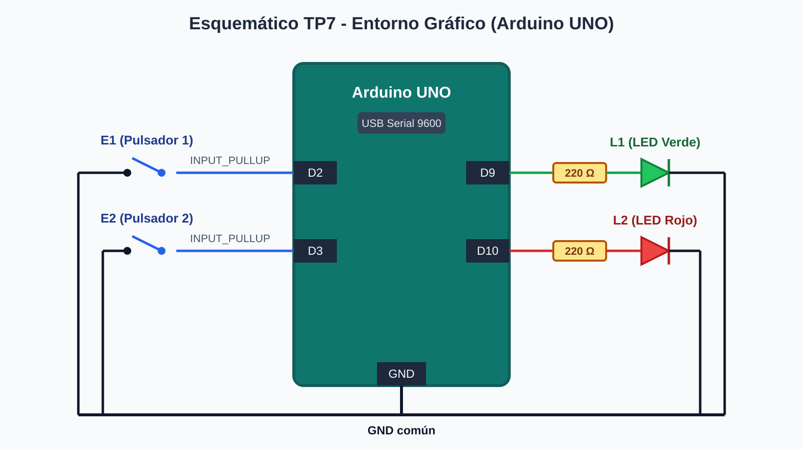

# TP7 - Entorno Gráfico (Arduino UNO + Processing)

**Cátedra:** Informática II — Ingeniería Electrónica (2026)  
**Tema:** Entorno gráfico y control bidireccional de E/S por puerto serie USB.

## Introducción

Este proyecto implementa una interfaz gráfica en **Processing** conectada por puerto serie USB a un **Arduino UNO** para monitorear dos entradas digitales (`E1`, `E2`) y controlar dos salidas (`L1`, `L2`):

1. **Visualización de estados:** el sector **Entradas** muestra con colores el estado `ALTO` (verde) o `BAJO` (gris) de los pulsadores físicos (`E1`, `E2`), y el sector **Salidas** muestra el estado de los LEDs (`L1`, `L2`).
2. **Control desde la PC:** al hacer clic con el mouse sobre los círculos `L1` o `L2` en Processing, se conmuta el LED correspondiente en el Arduino.
3. **Control desde el Arduino:** al presionar el pulsador `E1` o `E2` en la protoboard, el Arduino conmuta la salida correspondiente (`E1 → L1`, `E2 → L2`) y actualiza la interfaz en Processing.
4. **Comunicación bidireccional:** Arduino y Processing intercambian comandos y estados en tiempo real a `9600` baudios.

## Estructura del proyecto

```text
.
├── .vscode/
│   └── extensions.json                              # Extensiones recomendadas (PlatformIO + Processing)
├── platformio.ini                                   # Configuración PlatformIO (Arduino UNO, 9600 bps)
├── src/
│   └── main.cpp                                     # Firmware Arduino (lectura con debounce + serial)
├── processing/
│   └── TP7_EntornoGrafico/
│       └── TP7_EntornoGrafico.pde                   # Interfaz gráfica minimalista en Processing 4
└── docs/
    └── esquematico.png                              # Esquemático de conexiones
```

## Materiales y conexiones

### Materiales
- 1x **Arduino UNO** + cable USB de datos
- 1x **Protoboard**
- 2x **Pulsadores** (o llaves) para `E1` y `E2`
- 2x **LEDs** (por ejemplo verde y rojo) para `L1` y `L2`
- 2x **Resistencias de `220 Ω`** (una por cada LED)
- Cables jumper

### Tabla de conexiones

| Componente | Pin Arduino UNO | Conexión |
|---|---|---|
| Pulsador `E1` | `D2` | Entre `D2` y `GND` (usa `INPUT_PULLUP` interno) |
| Pulsador `E2` | `D3` | Entre `D3` y `GND` (usa `INPUT_PULLUP` interno) |
| LED `L1` | `D9` | `D9` → resistencia `220 Ω` → ánodo (+) / cátodo (-) → `GND` |
| LED `L2` | `D10` | `D10` → resistencia `220 Ω` → ánodo (+) / cátodo (-) → `GND` |

> **Tip para pulsadores de 4 patas:** colocalos cruzando el canal central de la protoboard y conectá **dos patas en diagonal** (una a `D2`/`D3` y la opuesta a `GND`). Así te asegurás de usar los dos lados del contacto interno.



## Protocolo serial (`9600` baudios)

- **Arduino → PC:** `e1,e2,l1,l2\n` (cada campo vale `0` o `1`, enviado ante cada cambio y cada `100 ms`).
- **PC → Arduino:**
  - `'A'` / `'a'`: enciende / apaga `L1`
  - `'B'` / `'b'`: enciende / apaga `L2`

---

## Cómo hacerlo funcionar con Visual Studio Code (PlatformIO + Processing)

### Requisitos previos
1. Tener instalado **Visual Studio Code**.
2. Tener instalado **Processing 4** en tu sistema (la extensión de VS Code utiliza el ejecutable de Processing instalado).
3. *(Solo Linux)* Tener permisos para acceder al puerto serie USB:
   ```bash
   sudo usermod -aG dialout $USER
   ```
   *(Cerrá sesión y volvé a iniciar para que tome el cambio).*

### Paso 1: Instalar las extensiones en VS Code
Al abrir la carpeta del proyecto en VS Code, aparecerá un aviso para instalar las extensiones recomendadas (definidas en `.vscode/extensions.json`). También podés buscarlas manualmente en la pestaña **Extensions** (`Ctrl+Shift+X`):

- **PlatformIO IDE** (`platformio.platformio-ide`) — para compilar y subir el firmware al Arduino UNO.
- **Processing** (`processing-foundation.processing-vscode-extension`) — para ejecutar el sketch `.pde` directamente desde VS Code.

### Paso 2: Compilar y subir el código al Arduino UNO (PlatformIO)
1. Conectá el **Arduino UNO** a la PC por USB.
2. En la barra inferior de VS Code (barra azul de PlatformIO):
   - Hacé clic en **Build (`✓`)** para verificar que compila sin errores.
   - Hacé clic en **Upload (`→`)** para grabar el programa en el Arduino UNO.
3. *(Opcional)* Podés abrir **Serial Monitor** (ícono de enchufe en la barra inferior) para ver los datos `0,0,0,0` llegando a `9600` baudios.
   > **Importante:** cerrá el Serial Monitor antes de iniciar Processing, porque ambos programas no pueden usar el mismo puerto USB al mismo tiempo.

### Paso 3: Ejecutar la interfaz gráfica (extensión Processing)
1. Abrí el archivo `processing/TP7_EntornoGrafico/TP7_EntornoGrafico.pde` en VS Code.
2. Hacé clic en el botón **▶ (Run)** arriba a la derecha del editor (o presioná `Ctrl+Shift+P` → `Processing: Run Sketch`).
3. Se abrirá la ventana **TP7 - Entorno Gráfico** conectada automáticamente al puerto del Arduino:
   - Al **presionar `E1` o `E2`** en la protoboard, cambia el color de la entrada y se conmuta el LED correspondiente (`L1` o `L2`).
   - Al **hacer clic en `L1` o `L2`** en la ventana, se enciende o apaga el LED físico en el Arduino.
   - Si conectaste el Arduino después de abrir Processing, presioná la tecla **`R`** dentro de la ventana para reconectar el puerto serie.

---

## Videos de demostración

- **Video:** [Ver en YouTube](https://www.youtube.com/watch?v=0Ywf7iApe0o)
